<!-- header:start -->
<div align="center">



<a href="#-quick-start"></a>

<a href="LICENSE"></a>

<a href="https://github.com/ajendras/voxora/stargazers"></a>
<a href="https://github.com/ajendras/voxora/actions/workflows/ci.yml"></a>

<a href="CONTRIBUTING.md"></a>

**Self-hosted PHP platform for secure AI text-to-speech, voice management and workflow automation**

[✨ Features](#-features) • [⚡ Quick start](#-quick-start) • [🧰 Usage](#-usage) • [🧩 Architecture](#-architecture) • [📍 Roadmap](#-roadmap) • [🤝 Contributing](#-contributing)

</div>
<!-- header:end -->

## ✨ Why Voxora?

Developers integrating high-quality voices face fragmented provider APIs, exposed keys and repetitive manual tasks. Voxora is a unified self-hosted PHP control plane that adds strong security, token scoping, batch automation and a clean dashboard, bridging raw TTS services and production apps.

- **Secure by default** — `KeyManager` issues encrypted, scoped, auto-expiring tokens using Sodium; no keys are ever exposed in your frontend or logs.
- **Single unified interface** — `TTS\Manager::generate()` routes through `ProviderInterface` implementations (currently `ElevenLabsProvider`) with automatic SQLite caching.
- **Zero-copy automation** — `BatchGenerator::run()` turns a CSV into dozens of MP3s in one call, with optional progress callbacks and a full `Report`.
- **Instant UI + REST** — Responsive HTMX/Tailwind dashboard and a token-protected JSON API let you preview, download or embed speech from any app.
- **Local fallback** — Seamless offline synthesis via Piper when cloud providers are unavailable.
- **Voice cloning** — Upload audio samples directly to provider APIs (`Manager::cloneVoice()`) with results persisted as reusable custom voices.

## 🎬 Demo

<p align="center"></p>

## 🚀 Features

<table>
<tr>
<td valign="top" width="33%">
🔐 <b>Secure Vault</b><br>
Encrypted scoped tokens with <code>KeyManager::issueToken()</code> and <code>validate()</code>
</td>
<td valign="top" width="33%">
🌐 <b>Unified Engine</b><br>
<code>TTS\Manager</code> + <code>ProviderInterface</code> for ElevenLabs (and future providers)
</td>
<td valign="top" width="33%">
🎙️ <b>Instant Synth</b><br>
HTMX form in <code>DashboardController::generateAction()</code> with rich SSML editor + live preview
</td>
</tr>
<tr>
<td valign="top">
📦 <b>Batch Runner</b><br>
<code>BatchGenerator::run()</code> parses CSV, writes MP3s and returns a <code>Report</code>
</td>
<td valign="top">
📚 <b>Voice Library</b><br>
Curated voices stored and retrieved via <code>SqliteRepository::listLibrary()</code>
</td>
<td valign="top">
📊 <b>Analytics Hub</b><br>
Usage stats, history and cost tracking through <code>SqliteRepository::getUsageStats()</code>
</td>
</tr>
<tr>
<td valign="top">
🔌 <b>REST API</b><br>
<code>ApiController</code> endpoints (<code>speechAction</code>, <code>historyAction</code>, <code>issueTokenAction</code>)
</td>
<td valign="top">
🛡️ <b>Token Scoping</b><br>
<code>Token::hasScope()</code> enforces <code>tts:generate</code> on protected routes
</td>
<td valign="top">
📢 <b>Local TTS</b><br>
Piper fallback via Symfony Process — fully offline synthesis on cloud failure
</td>
</tr>
<tr>
<td valign="top" colspan="3">
🔄 <b>Voice Cloning</b><br>
Upload sample audio via <code>/api/v1/clone-voice</code> or Library UI; <code>Manager::cloneVoice()</code> calls provider APIs (ElevenLabs /v1/voices/add), persists voice_id in SQLite for immediate reuse
</td>
</tr>
</table>

## 📦 Installation

**Requirements**

- PHP 8.2+ with `ext-sqlite3`, `ext-sodium`, `ext-json`
- Composer
- (Optional) Piper binary + voice model for local fallback

```bash
composer create-project ajendras/voxora voxora-app
cd voxora-app

# Copy and edit configuration (add your ElevenLabs key)
cp config/app.example.php config/app.php

# Start the built-in server
composer run serve
```

The app will be available at http://localhost:8080/login (default admin/demo123).

## 🗣️ Local TTS with Piper

Voxora automatically falls back to fully offline TTS using the Piper engine (via Symfony Process) when the primary provider fails or is unavailable.

**Setup steps:**

1. Download the Piper binary for your OS from https://github.com/rhasspy/piper/releases
2. Download a voice model (e.g. `en_US-lessac-medium.onnx`) from https://huggingface.co/rhasspy/piper-voices
3. Configure in `config/app.php`:

```php
'providers' => [
    'eleven' => [
        'api_key' => 'your_elevenlabs_key',
        'base_uri' => 'https://api.elevenlabs.io/v1',
    ],
    'piper' => [
        'binary' => 'piper', // or absolute path e.g. '/usr/local/bin/piper'
        'model' => __DIR__ . '/../models/en_US-lessac-medium.onnx',
    ],
],
```

The `TTS\Manager::generate()` call will transparently fallback. WAV output is returned for local generations. Explicit usage: `provider: 'piper'`.

## ⚡ Quick start

```php
<?php
require __DIR__ . '/vendor/autoload.php';

use Voxora\Kernel;

$config = require __DIR__ . '/config/app.php';
$kernel = new Kernel($config);
$kernel->boot();

$manager = $kernel->getTtsManager();

// Voice cloning workflow
$voiceId = $manager->cloneVoice(
    name: "My Custom Narrator",
    samplePath: __DIR__ . "/samples/narrator.wav",
    provider: "elevenlabs"
);
echo "Cloned voice ready: $voiceId\n";

// Standard synthesis with cloned voice
$result = $manager->generate(
    text: "Hello from your cloned voice.",
    voiceId: $voiceId,
    provider: "elevenlabs"
);

$result->save('output/cloned.mp3');
echo "Saved! Duration: " . ($result->duration ?? 'unknown') . "s\n";
```

## 🧰 Usage

### Authentication

Default credentials (change immediately in production by editing the database or extending user management):

- **Administrator**: `admin` / `demo123` (full access, can issue tokens with elevated roles)
- **Regular user**: `user` / `demo123` (standard tts:generate access, own history only)

After login the top bar reflects the current user and role. Admins see additional navigation options. All dashboard actions require an active session. API tokens can now carry a `role` for RBAC.

### Dashboard synthesis (HTMX)

Visit `/dashboard` (after login), fill the form and click **GENERATE SPEECH**. The `DashboardController::generateAction()` returns a live audio fragment with player, download button and metadata. Stats and history are scoped to the logged-in user.

### Rich SSML Editor

The dashboard synthesis panel now includes a rich SSML editor. A toolbar provides one-click insertion of common SSML tags (`<break>`, `<prosody>`, `<emphasis>`, `<say-as>`). 

- Place cursor or select text in the editor.
- Click a toolbar button to insert or wrap with the tag.
- Full SSML is supported; `<speak>` root is optional for ElevenLabs/Piper.
- The right-hand panel delivers a **live preview** (HTMX-updated inline audio player) immediately after generation.

Example SSML:

```xml
Hello <break time="800ms"/> my name is <prosody rate="slow" pitch="-5%">Voxora</prosody>.
<emphasis level="strong">This is important.</emphasis>
```

The generated audio respects all prosody, pauses and emphasis.

### Voice cloning workflow

**Via API (recommended for scripts):**

```bash
curl -X POST http://localhost:8080/api/v1/clone-voice \
  -H "X-Api-Key: vxo_..." \
  -F "name=My Narrator" \
  -F "sample=@/path/to/sample.wav"
```

**Via Dashboard:** Visit /library. The "Clone New Voice" form accepts an audio sample (MP3/WAV), sends it to the ElevenLabs API, stores the resulting voice_id and displays it with a CLONED badge. Cloned voices are instantly selectable in the synthesis form.

**Via code:**

```php
$voiceId = $manager->cloneVoice(
    name: "My Custom Narrator",
    samplePath: "samples/narrator.wav"
);
```

The sample is posted as multipart to the provider, the voice is persisted in the `voices` SQLite table (with `is_cloned=1`), and can be used in any `generate()` call.

### Issue a scoped API token

```php
$keyManager = $kernel->getKeyManager();
$token = $keyManager->issueToken(
    name: "Mobile App Integration",
    scopes: ["tts:generate"],
    role: "user"
);
echo "Token: $token\n";
```

Use the token in the `Authorization: Bearer` header or `X-Api-Key` for `/api/v1/speech`. The `Token` object now exposes `role` and `userId` for role-based decisions.

### Batch processing from CSV

```php
use Voxora\Automation\BatchGenerator;

$generator = new BatchGenerator($manager, outputDir: 'output');
$report = $generator->run('scripts/podcast.csv', function (int $cur, int $tot, string $msg) {
    echo "[$cur/$tot] $msg\n";
});

echo $report->getSummary() . "\n";
print_r($report->toArray());
```

<details><summary>Advanced: custom Report handling + progress with file links</summary>

```php
$report = $generator->run('large-batch.csv', $progressCallback);

if ($report->failed > 0) {
    echo "Failures: " . $report->failed . "\n";
    foreach ($report->files as $file) {
        echo "→ $file\n";
    }
}
```
</details>

### Call the JSON API directly

```bash
curl -X POST http://localhost:8080/api/v1/speech \
  -H "X-Api-Key: vxo_..." \
  -d 'text=Welcome to the control plane.&voice_id=21m00Tcm4TlvDq8ikWAM'
```

Provider can be set to `piper` for local synthesis. Use `/api/v1/clone-voice` for cloning. SSML inside the `text` field is passed through to the provider.

## 🔧 Configuration

| Option                        | Default               | Description |
|-------------------------------|-----------------------|-------------|
| `security.encrypt_key`        | (required)            | Master key used by `KeyManager` to derive the Sodium secretbox key |
| `security.token_lifetime_days`| 90                    | Default expiry for tokens issued by `KeyManager::issueToken()` |
| `storage.path`                | `data/voxora.db`      | SQLite database path passed to `SqliteRepository` |
| `providers.eleven.api_key`    | (required)            | ElevenLabs API key used by `ElevenLabsProvider` |
| `providers.eleven.base_uri`   | `https://api.elevenlabs.io/v1` | Base URL for the ElevenLabs API |
| `providers.piper.binary`      | `piper`               | Path to Piper CLI binary (must be executable) |
| `providers.piper.model`       | (required for fallback) | Path to Piper .onnx voice model file |
| `audio.directory`             | `storage/audio`       | Directory where `ApiController::speechAction()` saves generated MP3s |
| `audio.public_url_prefix`     | `/audio`              | Public URL prefix returned in JSON responses |

All values are defined in `config/app.php` and loaded by `Kernel`.

## 🧩 Architecture

```mermaid
flowchart TD
    Request[HTTP Request] --> Index[public/index.php]
    Index --> Kernel[Kernel::boot + handle]
    Kernel --> Session[session_start + Auth]
    Kernel --> Router[Router]
    Router --> Dashboard[DashboardController<br>(login, index, generate)]
    Router --> Api[ApiController<br>(cloneVoiceAction)]
    Api --> KeyManager[KeyManager::validate<br>(role + userId)]
    Api --> Manager[TTS\Manager::generate or cloneVoice]
    Dashboard --> Manager
    Manager --> Provider[ProviderInterface]
    Provider --> ElevenLabs[ElevenLabsProvider<br>(/voices/add for cloning)]
    Provider --> Piper[PiperProvider<br>(throws on clone)]
    Manager --> Fallback[Fallback to Piper on cloud error]
    Manager --> Repo[SqliteRepository<br>(users, generations, voices with is_cloned)]
    Upload[Sample Upload] --> Api
    Api --> Manager
    Manager --> Repo[saveCustomVoice]
    Batch[BatchGenerator::run] --> Manager
    Manager --> Synthesis[SynthesisResult<br>(save, toDataUri)]
    Users[(users table<br>role-based)]
```

`Kernel` wires together `KeyManager`, `TTS\Manager`, `SqliteRepository` and the two controllers. All synthesis paths converge on `Manager::generate()`, which selects a `ProviderInterface` implementation, caches results and records usage. The dashboard uses HTMX fragments while the API returns JSON with public audio URLs. Sessions + `users` table enable multi-user isolation and role checks (`admin` vs `user`). Piper is used as automatic fallback for offline/resilient operation. Voice cloning is handled by `Manager::cloneVoice()` which delegates to the provider, stores the voice, and makes it available in `listLibrary()`. The new SSML editor lives inside `DashboardController::renderSynthPanel()` with pure-JS tag insertion that feeds directly into the existing HTMX generation flow.

## 📁 Project structure

```text
.
├── composer.json                 # Dependencies, scripts (serve, test), PSR-4 autoload
├── config/app.php                # providers, security.encrypt_key, storage.path
├── public/
│   └── index.php                 # Front controller — registers Router & Kernel
├── src/
│   ├── Kernel.php                # Bootstraps services, creates Manager + KeyManager, starts session
│   ├── Security/
│   │   └── KeyManager.php        # issueToken(), validate(), Token (now with role/userId), User concepts
│   ├── TTS/
│   │   ├── ProviderInterface.php # synthesize() + cloneVoice()
│   │   ├── ElevenLabsProvider.php # implements cloning via /v1/voices/add
│   │   ├── PiperProvider.php     # local synthesis via Symfony Process + WAV output (throws on clone)
│   │   ├── SynthesisResult.php   # common result value object (mp3/wav)
│   │   └── Manager.php           # generate() with caching, usage recording & Piper fallback; cloneVoice()
│   ├── Http/
│   │   ├── DashboardController.php # HTMX pages + generateAction + login/logout + rich SSML editor
│   │   └── ApiController.php     # speechAction, historyAction, issueTokenAction, cloneVoiceAction (role-aware)
│   ├── Storage/
│   │   └── SqliteRepository.php  # schema (users + voices with is_cloned), authenticate(), listLibrary(), saveCustomVoice()
│   └── Automation/
│       └── BatchGenerator.php    # run(csvPath, progress), Report value object
├── examples/
│   └── batch.php                 # CLI demo using Manager + BatchGenerator
├── tests/
│   └── Unit/
│       └── KeyManagerTest.php    # token issuance, validation, expiry, scopes, roles
└── data/                         # SQLite DB and generated audio (gitignored)
```

## 🧪 Testing

```bash
composer test
# or
vendor/bin/phpunit
```

The test suite covers `KeyManager` token issuance, validation, expiry checks, encryption round-trips, scope enforcement and the new role/userId fields. New unit tests validate Piper WAV duration parsing and fallback paths. `PiperProviderTest` now also asserts that `cloneVoice()` throws the expected exception.

## 📍 Roadmap

<!-- roadmap:start -->
- [x] **v0.1.0** — first release: Secure Vault, Unified Engine, Instant Synth, Batch Runner
- [x] Add user authentication and role-based multi-user support
- [x] Local TTS fallback via Piper using Symfony Process component
- [x] Voice cloning workflow with sample upload to provider APIs
- [x] Rich SSML editor with live preview inside dashboard
- [ ] FFmpeg integration for normalization, loudness and format conversion
- [ ] Interactive usage analytics dashboard with Chart.js charts
- [ ] Configurable webhooks on successful generation
- [ ] Redis-backed rate limiter and request throttling
- [ ] Plugin system for registering new TTS providers at runtime
- [ ] Scheduled batch jobs using native cron expressions
- [ ] Dark/light mode persistence and improved accessibility
- [ ] Exportable voice library as portable JSON bundles

> 🤖 This roadmap is worked through continuously — ideas and PRs welcome!
<!-- roadmap:end -->

## 🤝 Contributing

We love community contributions! Whether it's a new TTS provider, improved UI fragment, or a documentation fix, please open a PR.

Read our [CONTRIBUTING.md](https://github.com/ajendras/voxora/blob/main/CONTRIBUTING.md) and follow the [CODE_OF_CONDUCT.md](https://github.com/ajendras/voxora/blob/main/CODE_OF_CONDUCT.md). Good-first-issues are tagged and welcome — come say hi in the discussions!

## 📄 License

This project is licensed under the MIT License — see the [LICENSE](https://github.com/ajendras/voxora/blob/main/LICENSE) file for details.

<!-- footer:start -->
<div align="center">

### ⭐ Star history

<a href="https://star-history.com/#ajendras/voxora&Date"></a>

If **Voxora** saves you time, a ⭐ helps others find it.

Made with ❤️ by [Ajendra](https://ajendra.info)


</div>
<!-- footer:end -->
