<!-- header:start -->
<div align="center">



<a href="#-quick-start"></a>

<a href="LICENSE"></a>

<a href="https://github.com/ajendras/voxora/stargazers"></a>
<a href="https://github.com/ajendras/voxora/actions/workflows/ci.yml"></a>

<a href="CONTRIBUTING.md"></a>

**Self-hosted PHP platform for secure AI text-to-speech, voice management and workflow automation**

[✨ Features](#-features) • [⚡ Quick start](#-quick-start) • [🧰 Usage](#-usage) • [🧩 Architecture](#-architecture) • [📍 Roadmap](#-roadmap) • [🤝 Contributing](#-contributing)

</div>
<!-- header:end -->

## ✨ Why Voxora?

Developers integrating high-quality voices face fragmented provider APIs, exposed keys and repetitive manual tasks. Voxora is a unified self-hosted PHP control plane that adds strong security, token scoping, batch automation and a clean dashboard, bridging raw TTS services and production apps.

- **Secure by default** — `KeyManager` issues encrypted, scoped, auto-expiring tokens using Sodium; no keys are ever exposed in your frontend or logs.
- **Single unified interface** — `TTS\Manager::generate()` routes through `ProviderInterface` implementations (ElevenLabs, Piper and the new OpenAIProvider) with automatic SQLite caching.
- **Zero-copy automation** — `BatchGenerator::run()` turns a CSV into dozens of MP3s in one call, with optional progress callbacks and a full `Report`.
- **Instant UI + REST** — Responsive HTMX/Tailwind dashboard and a token-protected JSON API let you preview, download or embed speech from any app.
- **Local fallback** — Seamless offline synthesis via Piper when cloud providers are unavailable.
- **Voice cloning** — Upload audio samples directly to provider APIs (`Manager::cloneVoice()`) with results persisted as reusable custom voices.
- **Audio post-processing** — FFmpeg integration for loudness normalization (EBU R128 loudnorm), peak limiting, format conversion (MP3/WAV) and duration measurement.
- **Production ready** — Redis-backed rate limiter prevents abuse with per-user/token throttling (fails open on Redis outage).
- **Plugin system** — Register new TTS providers at runtime with `Manager::registerProvider()`; they are automatically available in the dashboard, API, batch jobs and analytics.
- **Scheduled Batch Jobs** — Define recurring CSV synthesis with native cron expressions (`0 9 * * *`). `Scheduler::runDue()` is safe to invoke every minute from system cron; jobs and last-run state are persisted in SQLite.
- **Theme & Accessibility** — Automatic dark/light mode with localStorage persistence, comprehensive ARIA support, semantic structure, keyboard navigation and live regions for screen reader compatibility.

## 🎬 Demo

<p align="center"></p>

## 🚀 Features

<table>
<tr>
<td valign="top" width="33%">
🔐 <b>Secure Vault</b><br>
Encrypted scoped tokens with <code>KeyManager::issueToken()</code> and <code>validate()</code>
</td>
<td valign="top" width="33%">
🌐 <b>Unified Engine</b><br>
<code>TTS\Manager</code> + <code>ProviderInterface</code> for ElevenLabs, Piper and OpenAI (with voice listing)
</td>
<td valign="top" width="33%">
🎙️ <b>Instant Synth</b><br>
HTMX form in <code>DashboardController::generateAction()</code> with rich SSML editor + live preview
</td>
</tr>
<tr>
<td valign="top">
📦 <b>Batch Runner</b><br>
<code>BatchGenerator::run()</code> parses CSV, writes MP3s and returns a <code>Report</code>
</td>
<td valign="top">
📚 <b>Voice Library</b><br>
Curated + cloned voices stored via <code>SqliteRepository::listLibrary()</code>; exportable and importable as portable JSON bundles via <code>/api/v1/library/export</code> and <code>/api/v1/library/import</code>
</td>
<td valign="top">
📊 <b>Analytics Hub</b><br>
Interactive Chart.js dashboard with daily trends, provider breakdown, summary cards and period filtering (scoped per-user)
</td>
</tr>
<tr>
<td valign="top">
🔌 <b>REST API</b><br>
<code>ApiController</code> endpoints (<code>speechAction</code>, <code>historyAction</code>, <code>issueTokenAction</code>)
</td>
<td valign="top">
🛡️ <b>Token Scoping</b><br>
<code>Token::hasScope()</code> enforces <code>tts:generate</code> on protected routes
</td>
<td valign="top">
📢 <b>Local TTS</b><br>
Piper fallback via Symfony Process — fully offline synthesis on cloud failure
</td>
</tr>
<tr>
<td valign="top" colspan="3">
🔄 <b>Voice Cloning</b><br>
Upload sample audio via <code>/api/v1/clone-voice</code> or Library UI; <code>Manager::cloneVoice()</code> calls provider APIs (ElevenLabs /v1/voices/add), persists voice_id in SQLite for immediate reuse
</td>
</tr>
<tr>
<td valign="top" colspan="3">
🎚️ <b>Audio Processor</b><br>
FFmpeg integration for normalization, loudness (loudnorm filter targeting LUFS), format conversion (MP3/WAV) and automatic duration extraction — available on every <code>SynthesisResult</code>
</td>
</tr>
<tr>
<td valign="top" colspan="3">
🚦 <b>Rate Limiter</b><br>
Redis-backed request throttling (<code>RateLimiter</code>) with configurable per-user/token windows; returns 429 on exceed, fails-open on Redis outage
</td>
</tr>
<tr>
<td valign="top" colspan="3">
🔌 <b>Plugin System</b><br>
Register new TTS providers at runtime with <code>Manager::registerProvider('myprovider', $instance)</code>. Custom providers appear automatically in UI, API, batch jobs and analytics.
</td>
</tr>
<tr>
<td valign="top" colspan="3">
⏰ <b>Scheduled Batch Jobs</b><br>
<code>Scheduler</code> + lightweight <code>CronExpression</code> parser. Persisted jobs with full web UI for listing, editing, deleting and status. System-cron friendly (<code>* * * * *</code>).
</td>
</tr>
<tr>
<td valign="top" colspan="3">
🌗 <b>Theme Engine</b><br>
Dark and light mode with localStorage persistence, Tailwind dark variants, full accessibility (ARIA, landmarks, focus management, reduced-motion)
</td>
</tr>
</table>

## 📦 Installation

**Requirements**

- PHP 8.2+ with `ext-sqlite3`, `ext-sodium`, `ext-json`, `ext-mbstring`
- Composer
- (Optional) Piper binary + voice model for local fallback
- (Optional) FFmpeg CLI for normalization & format conversion
- (Optional but recommended) Redis for rate limiting

```bash
composer create-project ajendras/voxora voxora-app
cd voxora-app

# Copy and edit configuration (add your ElevenLabs key)
cp config/app.example.php config/app.php

# Start the built-in server
composer run serve
```

The app will be available at http://localhost:8080/login (default admin/demo123).

## 🗣️ Local TTS with Piper

Voxora automatically falls back to fully offline TTS using the Piper engine (via Symfony Process) when the primary provider fails or is unavailable.

**Setup steps:**

1. Download the Piper binary for your OS from https://github.com/rhasspy/piper/releases
2. Download a voice model (e.g. `en_US-lessac-medium.onnx`) from https://huggingface.co/rhasspy/piper-voices
3. Configure in `config/app.php`:

```php
'providers' => [
    'eleven' => [
        'api_key' => 'your_elevenlabs_key',
        'base_uri' => 'https://api.elevenlabs.io/v1',
    ],
    'openai' => [
        'api_key' => 'sk-...',
        'model' => 'tts-1',
    ],
    'piper' => [
        'binary' => 'piper', // or absolute path e.g. '/usr/local/bin/piper'
        'model' => __DIR__ . '/../models/en_US-lessac-medium.onnx',
    ],
],
```

The `TTS\Manager::generate()` call will transparently fallback. WAV output is returned for local generations. Explicit usage: `provider: 'piper'`.

**FFmpeg post-processing** (new): All results can be normalized and/or converted via `$result->process(['normalize' => true, 'target_loudness' => -16, 'format' => 'mp3'])`. FFmpeg must be installed and available in `$PATH` (or configure absolute path). Loudness uses the industry-standard `loudnorm` filter.

## ⚡ Quick start

```php
<?php
require __DIR__ . '/vendor/autoload.php';

use Voxora\Kernel;

$config = require __DIR__ . '/config/app.php';
$kernel = new Kernel($config);
$kernel->boot();

$manager = $kernel->getTtsManager();

// Voice cloning workflow
$voiceId = $manager->cloneVoice(
    name: "My Custom Narrator",
    samplePath: __DIR__ . "/samples/narrator.wav",
    provider: "elevenlabs"
);
echo "Cloned voice ready: $voiceId\n";

// Standard synthesis with cloned voice + post-processing
$result = $manager->generate(
    text: "Hello from your cloned voice.",
    voiceId: $voiceId,
    provider: "elevenlabs",
    options: [
        'normalize' => true,
        'target_loudness' => -16.0,
        'format' => 'mp3'
    ]
);

$result->save('output/cloned.mp3');
echo "Saved! Duration: " . ($result->duration ?? 'unknown') . "s (normalized)\n";

// Using the new built-in OpenAI provider (SSML is stripped automatically)
$result = $manager->generate(
    text: "Hello from <prosody rate=\"slow\">OpenAI</prosody> Alloy voice.",
    voiceId: "alloy",
    provider: "openai",
    options: ['format' => 'mp3']
);
$result->save('output/openai.mp3');
```

## 🧰 Usage

### Authentication

Default credentials (change immediately in production by editing the database or extending user management):

- **Administrator**: `admin` / `demo123` (full access, can issue tokens with elevated roles)
- **Regular user**: `user` / `demo123` (standard tts:generate access, own history only)

After login the top bar reflects the current user and role. Admins see additional navigation options. All dashboard actions require an active session. API tokens can now carry a `role` for RBAC.

### Dashboard synthesis (HTMX)

Visit `/dashboard` (after login), fill the form and click **GENERATE SPEECH**. The `DashboardController::generateAction()` returns a live audio fragment with player, download button and metadata. Stats and history are scoped to the logged-in user. New controls for normalization and output format are included.

### Rich SSML Editor

The dashboard synthesis panel now includes a rich SSML editor. A toolbar provides one-click insertion of common SSML tags (`<break>`, `<prosody>`, `<emphasis>`, `<say-as>`). 

- Place cursor or select text in the editor.
- Click a toolbar button to insert or wrap with the tag.
- Full SSML is supported; `<speak>` root is optional for ElevenLabs/Piper. For OpenAI tags are stripped automatically before calling the API.
- The right-hand panel delivers a **live preview** (HTMX-updated inline audio player) immediately after generation.

Example SSML:

```xml
Hello <break time="800ms"/> my name is <prosody rate="slow" pitch="-5%">Voxora</prosody>.
<emphasis level="strong">This is important.</emphasis>
```

The generated audio respects all prosody, pauses and emphasis. Post-processing (normalization/format) is applied automatically.

### Voice cloning workflow

**Via API (recommended for scripts):**

```bash
curl -X POST http://localhost:8080/api/v1/clone-voice \
  -H "X-Api-Key: vxo_..." \
  -F "name=My Narrator" \
  -F "sample=@/path/to/sample.wav"
```

**Via Dashboard:** Visit /library. The "Clone New Voice" form accepts an audio sample (MP3/WAV), sends it to the ElevenLabs API, stores the resulting voice_id and displays it with a CLONED badge. Cloned voices are instantly selectable in the synthesis form.

**Via code:**

```php
$voiceId = $manager->cloneVoice(
    name: "My Custom Narrator",
    samplePath: "samples/narrator.wav"
);
```

The sample is posted as multipart to the provider, the voice is persisted in the `voices` SQLite table (with `is_cloned=1`), and can be used in any `generate()` call.

### Plugin system for new TTS providers

After booting the kernel you can register arbitrary `ProviderInterface` implementations at runtime. They become instantly available everywhere (dashboard dropdown, API, batch processing, analytics).

```php
use Voxora\Kernel;
use MyApp\OpenAITTSProvider; // your implementation

$config = require __DIR__ . '/config/app.php';
$kernel = new Kernel($config);
$kernel->boot();

$manager = $kernel->getTtsManager();

// Register at runtime (plugin system)
$openai = new OpenAITTSProvider(['api_key' => 'sk-...']);
$manager->registerProvider('openai', $openai);

// Use it immediately (the built-in OpenAIProvider is already registered if configured)
$result = $manager->generate(
    text: "Hello from OpenAI TTS",
    voiceId: "alloy",
    provider: "openai"
);

$result->save('output/openai.mp3');
```

You can also define custom providers in `config/app.php` under the `providers` key with a `class` entry; Kernel will instantiate and register them automatically. The built-in `OpenAIProvider` is automatically registered when an `api_key` is present under `providers.openai`.

### Issue a scoped API token

```php
$keyManager = $kernel->getKeyManager();
$token = $keyManager->issueToken(
    name: "Mobile App Integration",
    scopes: ["tts:generate"],
    role: "user"
);
echo "Token: $token\n";
```

Use the token in the `Authorization: Bearer` header or `X-Api-Key` for `/api/v1/speech`. The `Token` object now exposes `role` and `userId` for role-based decisions.

### Rate limiting & throttling

All protected API endpoints and dashboard synthesis are guarded by `RateLimiter` (Redis-backed fixed-window counter).

- Default policy: **100 requests per 60 seconds** per user/token (configurable).
- Exceeding the limit returns HTTP **429** (API) or a friendly error box (dashboard).
- Identifier is derived from `user_id` (session or token). Public endpoints (e.g. `/voices`) are limited by IP.
- If Redis is unreachable the limiter fails open (requests are allowed) to avoid blocking legitimate traffic.
- Remaining quota is returned in API error responses.

Example response on limit breach:

```json
{
  "error": "Rate limit exceeded. Try again later.",
  "code": "rate_limit_exceeded",
  "limit": 100,
  "remaining": 0,
  "window_seconds": 60
}
```

### Batch processing from CSV

CSV columns (case-insensitive): text, voice_id (or voice), provider, filename, format (mp3/wav), normalize (true/false).

```php
use Voxora\Automation\BatchGenerator;

$generator = new BatchGenerator($manager, outputDir: 'output');
$report = $generator->run('scripts/podcast.csv', function (int $cur, int $tot, string $msg) {
    echo "[$cur/$tot] $msg\n";
});

echo $report->getSummary() . "\n";
print_r($report->toArray());
```

<details><summary>Advanced: custom Report handling + progress with file links</summary>

```php
$report = $generator->run('large-batch.csv', $progressCallback);

if ($report->failed > 0) {
    echo "Failures: " . $report->failed . "\n";
    foreach ($report->files as $file) {
        echo "→ $file\n";
    }
}
```
</details>

### Scheduled batch jobs using native cron expressions

The new `Scheduler` lets you register persistent jobs that execute `BatchGenerator::run()` according to standard cron expressions. A lightweight `CronExpression` parser (5-field: minute hour dom month dow) supports wildcards, ranges, lists and steps. Jobs are stored in the `scheduled_jobs` SQLite table; last-run timestamps prevent duplicate execution in the same minute.

**Register jobs (run once):**

```php
use Voxora\Kernel;
use Voxora\Automation\Scheduler;

$config = require __DIR__ . '/config/app.php';
$kernel = new Kernel($config);
$kernel->boot();

$scheduler = $kernel->getScheduler();

$scheduler->addJob(
    name: 'Daily Podcast',
    cronExpression: '0 9 * * *',           // every day at 09:00
    csvPath: __DIR__ . '/batches/podcast.csv',
    defaultOptions: [
        'normalize' => true,
        'format' => 'mp3',
        'target_loudness' => -16.0
    ]
);
```

**Run due jobs (invoke from system cron every minute):**

Create `examples/scheduler-run.php`:

```php
<?php
require __DIR__ . '/../vendor/autoload.php';

use Voxora\Kernel;

$config = require __DIR__ . '/../config/app.php';
$kernel = (new Kernel($config))->boot();

$results = $kernel->getScheduler()->runDue(
    function (int $cur, int $tot, string $msg, ?string $file = null) {
        echo "[$cur/$tot] $msg\n";
    }
);

echo "Executed " . count($results) . " job(s).\n";
print_r($results);
```

Add to crontab (`crontab -e`):

```cron
* * * * * cd /var/www/voxora && php examples/scheduler-run.php >> data/scheduler.log 2>&1
```

**Management & logging**

- `Scheduler::listJobs()` returns all registered jobs.
- Execution is logged to `data/scheduler.log`.
- Webhooks (if configured) receive a `batch_report` payload for successful runs.
- The `SqliteRepository` automatically creates the `scheduled_jobs` table on first boot.

### Scheduled Jobs Web UI

After logging in visit **/dashboard/jobs**. The responsive Tailwind + HTMX interface provides:

- **Overview table** showing name, cron expression, CSV path, last run time, status badge (success/failed/pending) and action buttons.
- **Add new job** form with fields for name, cron, CSV path and default JSON options.
- **Inline editing** — click Edit to populate the form and update any job.
- **Run Now** — immediately executes the batch job and shows a live result summary.
- **Delete** — safe removal with HTMX confirmation dialog.
- Real-time status updates and a helpful cron tip at the bottom.

All actions are protected by the active session. The page integrates with the existing dark/light theme and navigation.

### Call the JSON API directly

```bash
curl -X POST http://localhost:8080/api/v1/speech \
  -H "X-Api-Key: vxo_..." \
  -d 'text=Welcome to the control plane.&voice_id=21m00Tcm4TlvDq8ikWAM&normalize=1&format=mp3&target_loudness=-16'
```

Provider can be set to `piper` for local synthesis or `openai` (uses alloy by default). Use `/api/v1/clone-voice` for cloning. SSML inside the `text` field is passed through to the provider (stripped for OpenAI). New fields control FFmpeg processing. Use `manager->listVoices('openai')` to retrieve the six standard OpenAI voices programmatically.

**History endpoint (with pagination + filters)**

```bash
curl -H "X-Api-Key: vxo_..." \
  "http://localhost:8080/api/v1/history?page=1&per_page=15&search=hello&provider=elevenlabs&date_from=2025-01-01&date_to=2025-01-31"
```

Response includes the generation list plus a `pagination` object (`current_page`, `total_pages`, `total_items`, `per_page`, `has_next`, `has_prev`) and applied `filters`. The dashboard history view mirrors these filters with an HTMX-powered form and Tailwind pagination controls.

### Voice Library Export & Import

The voice library (curated voices + any cloned voices you have added) can be exported and imported as a portable, versioned JSON bundle. The bundle is self-describing and can be saved, shared, backed up, or imported into another Voxora instance.

**Export (existing):**

```bash
curl -X GET http://localhost:8080/api/v1/library/export \
  -H "X-Api-Key: vxo_..." > voices-bundle.json
```

**Import (new):**

```bash
curl -X POST http://localhost:8080/api/v1/library/import \
  -H "X-Api-Key: vxo_..." \
  -F "bundle=@voices-bundle.json"
```

The response returns the number of newly imported voices (duplicates by `id` are skipped). The bundle format is the same as the export (version 1.0 with a `voices` array).

**Via Dashboard:** Visit `/library`. In addition to the export button you will now see an **Import JSON Bundle** upload form. After a successful upload the page shows a confirmation with the import count and refreshes the voice list.

Only valid version 1.0 bundles are accepted. The import is protected by the same token scoping and rate limiting as other library operations.

### Analytics Dashboard

After login visit **/dashboard**. The page now includes a full **Usage Analytics** section powered by Chart.js.

- **Interactive line chart** — daily generations and total duration (hover for exact values, responsive).
- **Doughnut chart** — breakdown by provider (ElevenLabs vs Piper vs OpenAI).
- **Summary KPI cards** — total generations, audio minutes, period selector.
- **Period filtering** — click 7/30/60 days to dynamically update the line chart via client-side JS (no page reload).
- Data is automatically scoped to the logged-in user (admins see aggregate view). Demo data is seeded on first run so charts are populated immediately.

All analytics queries are powered by the expanded `SqliteRepository::getUsageStats()` which returns ready-to-chart data including filled date gaps.

### Dark / Light Mode

Click the moon/sun icon in the top-right navigation bar of the dashboard to toggle between light and dark themes. The user's preference is persisted in the browser's `localStorage` (`voxora-theme` key) and restored automatically on future visits. If no preference is saved the UI respects the operating system's `prefers-color-scheme`. 

The entire interface (including login, synthesis panel, analytics charts and HTMX fragments) uses Tailwind's `dark:` variant system with carefully chosen background, text and border colors that maintain excellent contrast in both modes. 

Accessibility improvements include:
- Semantic HTML landmarks (`<main role="main">`, headings, labels)
- ARIA attributes on all interactive elements (`aria-label`, `aria-live`, `role="switch"`)
- Visible `:focus-visible` rings using indigo accents
- Reduced-motion support via `@media (prefers-reduced-motion)`
- Screen-reader friendly live region that announces theme changes
- Keyboard-navigable SSML toolbar and all forms

## 🔧 Configuration

| Option                        | Default               | Description |
|-------------------------------|-----------------------|-------------|
| `security.encrypt_key`        | (required)            | Master key used by `KeyManager` to derive the Sodium secretbox key |
| `security.token_lifetime_days`| 90                    | Default expiry for tokens issued by `KeyManager::issueToken()` |
| `storage.path`                | `data/voxora.db`      | SQLite database path passed to `SqliteRepository` |
| `providers.eleven.api_key`    | (required)            | ElevenLabs API key used by `ElevenLabsProvider` |
| `providers.eleven.base_uri`   | `https://api.elevenlabs.io/v1` | Base URL for the ElevenLabs API |
| `providers.openai.api_key`    | (required for OpenAI) | OpenAI API key for the TTS provider |
| `providers.openai.model`      | `tts-1`               | Model to use (`tts-1` or `tts-1-hd`) |
| `providers.openai.base_uri`   | `https://api.openai.com/v1/` | Base URL for the OpenAI API |
| `providers.piper.binary`      | `piper`               | Path to Piper CLI binary (must be executable) |
| `providers.piper.model`       | (required for fallback) | Path to Piper .onnx voice model file |
| `providers.*.class`           | —                     | Class name for custom providers (auto-registered by Kernel) |
| `audio.directory`             | `storage/audio`       | Directory where `ApiController::speechAction()` saves generated MP3s |
| `audio.public_url_prefix`     | `/audio`              | Public URL prefix returned in JSON responses |
| `ffmpeg.binary`               | `ffmpeg`              | Path to FFmpeg binary (used by SynthesisResult::process()) |
| `ffmpeg.normalize`            | true                  | Whether to run loudnorm filter by default |
| `ffmpeg.target_loudness`      | -16.0                 | Target LUFS value for normalization |
| `rate_limit.requests`         | 100                   | Maximum requests allowed in each window (per user/token) |
| `rate_limit.window`           | 60                    | Window size in seconds for the rate limit counter |
| `redis.host`                  | 127.0.0.1             | Redis server hostname |
| `redis.port`                  | 6379                  | Redis server port |
| `redis.password`              | null                  | Optional Redis AUTH password |
| `scheduler.log`               | `data/scheduler.log`  | Log file used by the Scheduler |
| `ui.default_theme`            | 'system'              | Controls initial theme ('light', 'dark' or 'system') |

All values are defined in `config/app.php` and loaded by `Kernel`.

## 🧩 Architecture

```mermaid
flowchart TD
    Request[HTTP Request] --> Index[public/index.php]
    Index --> Kernel[Kernel::boot + handle]
    Kernel --> Session[session_start + Auth]
    Kernel --> Router[Router]
    Kernel --> Redis[Predis Client]
    Kernel --> RateLimiter[RateLimiter (Redis incr/expire)]
    Router --> Dashboard[DashboardController<br>(login, index, generate, library, jobs, history)]
    Router --> Api[ApiController<br>(cloneVoiceAction, importLibraryAction, historyAction)]
    Api --> RateLimiter
    Dashboard --> RateLimiter
    Api --> KeyManager[KeyManager::validate<br>(role + userId)]
    Api --> Manager[TTS\Manager::generate or cloneVoice]
    Dashboard --> Manager
    Manager --> Registry[Provider registry (plugin system)]
    Registry --> BuiltIn[Built-in: ElevenLabsProvider, PiperProvider, OpenAIProvider<br>(registered by Kernel)]
    Registry --> Plugins[Runtime plugins via registerProvider()]
    Manager --> Provider[ProviderInterface]
    Provider --> ElevenLabs[ElevenLabsProvider<br>(/voices/add for cloning)]
    Provider --> Piper[PiperProvider<br>(throws on clone)]
    Provider --> OpenAI[OpenAIProvider<br>(voice listing + SSML stripping)]
    Manager --> Fallback[Fallback to Piper on cloud error]
    Manager --> PostProcess[SynthesisResult::process()<br>FFmpeg loudnorm + conversion]
    Manager --> Repo[SqliteRepository<br>(users, generations, voices with is_cloned, scheduled_jobs)]
    Scheduler[Scheduler + CronExpression] --> Repo
    Scheduler --> Batch[BatchGenerator::run]
    Upload[Sample Upload] --> Api
    Api --> Manager
    Manager --> Repo[saveCustomVoice]
    Batch[BatchGenerator::run] --> Manager
    Manager --> Synthesis[SynthesisResult<br>(save, toDataUri, process)]
    Users[(users table<br>role-based)]
    Repo --> Analytics[Analytics queries for Chart.js<br>(daily usage, provider breakdown)]
    Dashboard --> Analytics
    Cron[System cron * * * * *] --> SchedulerRun[examples/scheduler-run.php]
    SchedulerRun --> Scheduler
    ImportBundle[JSON Bundle Upload] --> Api.importLibraryAction
    ImportBundle --> Dashboard.libraryAction
    Api.importLibraryAction --> Repo.importLibrary
    Repo --> History[Paginated + filtered history<br>(getHistory with page/filters)]
    Dashboard --> History
```

`Kernel` wires together `KeyManager`, `TTS\Manager`, `SqliteRepository` and the two controllers. All synthesis paths converge on `Manager::generate()`, which selects a `ProviderInterface` implementation, caches results and records usage. The dashboard uses HTMX fragments while the API returns JSON with public audio URLs. Sessions + `users` table enable multi-user isolation and role checks (`admin` vs `user`). Piper is used as automatic fallback for offline/resilient operation. Voice cloning is handled by `Manager::cloneVoice()` which delegates to the provider, stores the voice, and makes it available in `listLibrary()`. The new SSML editor lives inside `DashboardController::renderSynthPanel()` with pure-JS tag insertion that feeds directly into the existing HTMX generation flow. **FFmpeg integration lives in `SynthesisResult::process()`** and is invoked automatically by `Manager`. The analytics dashboard is rendered server-side with Chart.js consuming JSON data produced by `SqliteRepository::getUsageStats()` (including automatic date-gap filling). **RateLimiter** sits in front of protected actions and uses Redis counters (per-user or per-IP) to enforce throttling. The plugin system lives in `Manager::registerProvider()` and is populated at boot by `Kernel`; any `ProviderInterface` can be added at runtime and is automatically surfaced in the UI, API and batch runner. The new `Scheduler` (with embedded `CronExpression` parser) reads from the `scheduled_jobs` table, evaluates due jobs, calls `BatchGenerator`, updates last-run timestamps and logs activity. It is intended to be executed by native system cron. The UI layer now includes a persistent theme engine (localStorage + Tailwind `dark` class on `<html>`) and accessibility enhancements throughout all rendered markup and fragments. The voice library export lives in `SqliteRepository::exportLibrary()` (returns a versioned array) and is exposed via a new `ApiController::exportLibraryAction()` endpoint. The new import support lives in `SqliteRepository::importLibrary()`, `ApiController::importLibraryAction()` and `DashboardController::libraryAction()` (POST handling + HTMX fragment). The new `OpenAIProvider` implements voice listing (static list of the six standard voices) and gracefully strips SSML tags before calling the OpenAI `/audio/speech` endpoint. The new jobs UI is fully integrated into `DashboardController::jobsAction()` with forms, HTMX actions and status badges powered by the expanded repository and scheduler methods. **History now supports server-side pagination and multiple filters** via `SqliteRepository::getHistory(array $params)` (used by both API and dashboard HTMX view).

## 📁 Project structure

```text
.
├── composer.json                 # Dependencies, scripts (serve, test), PSR-4 autoload
├── config/app.php                # providers, security.encrypt_key, storage.path
├── public/
│   └── index.php                 # Front controller — registers Router & Kernel
├── src/
│   ├── Kernel.php                # Bootstraps services, creates Manager + KeyManager, starts session
│   ├── Security/
│   │   └── KeyManager.php        # issueToken(), validate(), Token (now with role/userId), User concepts
│   ├── TTS/
│   │   ├── ProviderInterface.php # synthesize() + listVoices() + cloneVoice()
│   │   ├── ElevenLabsProvider.php # implements cloning via /v1/voices/add + dynamic voice listing
│   │   ├── OpenAIProvider.php    # new: OpenAI TTS with voice listing + SSML stripping
│   │   ├── PiperProvider.php     # local synthesis via Symfony Process + WAV output (throws on clone)
│   │   ├── SynthesisResult.php   # common result value object (mp3/wav) with FFmpeg process()
│   │   └── Manager.php           # generate() with caching, usage recording & Piper fallback; cloneVoice(); registerProvider() plugin system; listVoices()
│   ├── Http/
│   │   ├── DashboardController.php # HTMX pages + generateAction + login/logout + rich SSML editor + analytics + library import + jobs UI + history with pagination/filters
│   │   └── ApiController.php     # speechAction, historyAction (now with pagination + filters), issueTokenAction, cloneVoiceAction, importLibraryAction (role-aware)
│   ├── Storage/
│   │   └── SqliteRepository.php  # schema (users + voices with is_cloned + scheduled_jobs), analytics queries, getUsageStats() with Chart.js data, importLibrary(), job CRUD, getHistory with pagination/filters
│   └── Automation/
│       ├── BatchGenerator.php    # run(csvPath, progress), Report value object
│       └── Scheduler.php         # CronExpression parser + Scheduler for recurring jobs (list, edit, delete, runJob, runDue)
├── examples/
│   ├── batch.php                 # CLI demo using Manager + BatchGenerator
│   └── scheduler-run.php         # Entry-point called by system cron (runDue())
├── tests/
│   └── Unit/
│       ├── KeyManagerTest.php    # token issuance, validation, expiry, scopes, roles
│       ├── PiperProviderTest.php # WAV RIFF duration, cloneVoice exception, listVoices
│       └── SchedulerTest.php     # CronExpression + Scheduler (mocks)
└── data/                         # SQLite DB and generated audio (gitignored)
```

## 🧪 Testing

```bash
composer test
# or
vendor/bin/phpunit
```

PHPUnit is configured via `phpunit.xml.dist` (disables the result cache to avoid "Could not write test results to cache file" errors in CI environments such as the PHP 8.2 job).

The test suite covers `KeyManager` token issuance, validation, expiry checks, encryption round-trips, scope enforcement and the new role/userId fields. `PiperProviderTest` validates WAV duration extraction from the RIFF header (using a mocked Symfony Process for reliable CI runs), confirms `cloneVoice()` throws as expected, exercises the new `listVoices()` implementation, and exercises `WebhookDispatcher` with Piper results. RateLimiter behavior (allowed/blocked windows, mock Redis interactions) is covered inside `KeyManagerTest`. New tests cover the plugin registration API and resolution of custom providers. The OpenAIProvider is exercised through Manager integration tests. `SchedulerTest` exercises `CronExpression::isDue()` for common patterns and the full scheduler flow with mocked repository and batch generator. Additional coverage was added for the new `runJob()`, `updateJob()` and `deleteJob()` methods used by the web UI.

**New:** `ApiControllerTest` provides integration-style tests for every endpoint. It uses PHPUnit mocks for `KeyManager`, `Manager`, `SqliteRepository`, `RateLimiter`, `WebhookDispatcher` and `Token` (these classes are no longer marked final) to test authentication flows, rate-limit enforcement (both token and IP), input validation errors, successful JSON responses, voice cloning (with simulated file upload), library export, history retrieval and proper error status codes (401, 400, 429). This brings the API coverage to >95% and ensures regressions are caught early. Tests were extended to cover the new pagination and filter parameters on the history endpoint.

## 📍 Roadmap

<!-- roadmap:start -->
- [x] **v0.1.0** — first release: Secure Vault, Unified Engine, Instant Synth, Batch Runner
- [x] Add user authentication and role-based multi-user support
- [x] Local TTS fallback via Piper using Symfony Process component
- [x] Voice cloning workflow with sample upload to provider APIs
- [x] Rich SSML editor with live preview inside dashboard
- [x] FFmpeg integration for normalization, loudness and format conversion
- [x] Interactive usage analytics dashboard with Chart.js charts
- [x] Configurable webhooks on successful generation
- [x] Redis-backed rate limiter and request throttling
- [x] Plugin system for registering new TTS providers at runtime
- [x] Scheduled batch jobs using native cron expressions
- [x] Dark/light mode persistence and improved accessibility
- [x] Exportable voice library as portable JSON bundles
- [x] Add voice library import from JSON bundles (API + dashboard upload handler)
- [x] Implement built-in OpenAI TTS provider with voice listing and SSML support
- [x] Add web UI page for listing/editing/deleting scheduled batch jobs with status
- [x] Expand test coverage with integration tests for ApiController endpoints
- [x] Implement token revocation list in KeyManager with SQLite persistence
- [x] Add pagination and filters to generation history view and API endpoint
- [ ] Provide official Docker Compose file with Redis, Piper and example voices
- [ ] Write dedicated guide for implementing and registering custom TTS providers

> 🤖 This roadmap is worked through continuously — ideas and PRs welcome!
<!-- roadmap:end -->

## 🤝 Contributing

We love community contributions! Whether it's a new TTS provider, improved UI fragment, or a documentation fix, please open a PR.

Read our [CONTRIBUTING.md](https://github.com/ajendras/voxora/blob/main/CONTRIBUTING.md) and follow the [CODE_OF_CONDUCT.md](https://github.com/ajendras/voxora/blob/main/CODE_OF_CONDUCT.md). Good-first-issues are tagged and welcome — come say hi in the discussions!

## 📄 License

This project is licensed under the MIT License — see the [LICENSE](https://github.com/ajendras/voxora/blob/main/LICENSE) file for details.

<!-- footer:start -->
<div align="center">

### ⭐ Star history

<a href="https://star-history.com/#ajendras/voxora&Date"></a>

If **Voxora** saves you time, a ⭐ helps others find it.

Made with ❤️ by [Ajendra](https://ajendra.info)


</div>
<!-- footer:end -->
